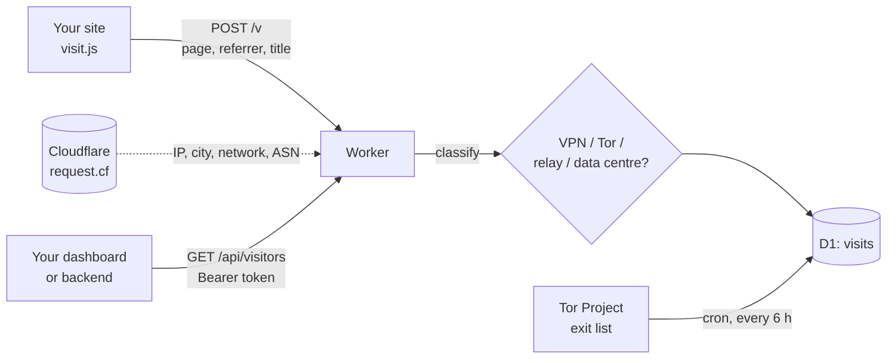

# edge-visitor-log

A privacy-friendly visitor log that runs on Cloudflare Workers and D1. Add one script tag to your site and see **who visits**: the network or company behind each visitor, their approximate location, the pages they viewed and where they came from, with **VPN, Tor, privacy-relay and data-centre connections flagged**.

No cookies, nothing stored in the browser, no third-party lookups. The IP, location and network come from Cloudflare itself, on the request that delivers the page view.



## Why

Analytics tools count visitors. When you sell to businesses, the useful question is *who* visited: "someone at Acme Corp in Austin read the pricing page twice after we emailed them". Cloudflare already knows each request's network (`asOrganization`), ASN and city, so a Worker can answer that without cookies, fingerprinting or a paid IP database.

## Features

- **One script tag.** `visit.js` sends the page, referrer and title with `navigator.sendBeacon`. It can't slow the page down or break it.
- **Network and location from Cloudflare.** IP, country, region, city, network name and ASN are read from `request.cf`, never from the browser.
- **Connection type.** Each visit is labelled when the IP isn't an ordinary home, office or mobile line:

  | Label | Meaning |
  |---|---|
  | `vpn` | A commercial VPN's network (NordVPN, Mullvad, Proton, M247, Datacamp...) |
  | `tor` | On the Tor Project's exit list, refreshed every 6 hours by the cron trigger |
  | `relay` | iCloud Private Relay or Cloudflare WARP (Cloudflare, Akamai, Fastly egress). Usually an ordinary person whose real IP is hidden |
  | `hosting` | Cloud and hosting networks (AWS, Google Cloud, Azure, DigitalOcean, Hetzner, OVH...): proxies, bots, or someone on a cloud machine |

  Decided from the ASN and network name (see [`src/network.js`](src/network.js)). Most VPNs (Astrill, ExpressVPN, Surfshark...) don't own their networks: they rent servers, so Cloudflare reports the server company ("Limestone Networks", "Leaseweb", "M247"), never the VPN's name. That's why the list covers the dedicated-server and VPS companies VPNs rent from, each checked against its registry (RDAP) record. It's a strong hint, not proof: VPNs that rent home IPs ("residential proxies") look ordinary.

  The simple answer is in `connection`: **`datacenter`** (any of the labels above) or **`residential`** (a home, office or mobile network, as far as the lists can tell).
- **Visitors, not just hits.** `/api/visitors` groups page views by IP and browser and returns totals, top pages, referring sites, countries and counts of masked connections.
- **Respects opt-outs.** Browsers that send Do Not Track or Global Privacy Control are not recorded (configurable). Bots, link previews and other origins are dropped.
- **Your own visits hidden.** Add your office and home IPs to the ignore list, or `POST /api/ignored-ips` with no body to ignore the IP you're calling from.
- **Retention built in.** The cron trigger deletes visits older than `RETENTION_DAYS`.
- **Reusable modules.** The beacon parsing, network classifier, Tor list and visitor grouping are pure ES modules you can import into your own backend: `edge-visitor-log/beacon`, `/network`, `/tor` and `/visitors`.

## Setup

```sh
npm install
cp wrangler.toml.example wrangler.toml          # set SITE_ORIGINS, and your domain if you want one
npx wrangler d1 create edge-visitor-log         # paste the printed database_id into wrangler.toml
npm run db:init                                 # create the tables
npx wrangler secret put API_TOKEN               # a long random string for /api/*
npm run deploy
```

Then add the script to every page of your site:

```html
<script src="https://visits.example.com/visit.js" defer></script>
```

The script posts to `/v` on the host it was loaded from. To host the file yourself, copy [`client/visit.js`](client/visit.js) and set `data-endpoint="https://visits.example.com/v"` on the tag.

| Variable | Default | |
|---|---|---|
| `SITE_ORIGINS` | (required) | Comma-separated origins allowed to send page views, e.g. `https://example.com,https://www.example.com` |
| `RETENTION_DAYS` | `365` | Visits older than this are deleted hourly. `0` keeps everything |
| `RESPECT_DNT` | `true` | `false` also records Do Not Track / GPC browsers |
| `API_TOKEN` | (secret) | Bearer token for `/api/*`. Without it, the API refuses every call |

## API

All `/api/*` calls need `Authorization: Bearer <API_TOKEN>`.

| Call | Returns |
|---|---|
| `GET /api/visitors?days=30&limit=200&includeIgnored=1` | `{ days, stats, visitors[] }`. `stats` has `views`, `visitors`, `visitorsLast24h`, `masked` (`{vpn, tor, relay, hosting}`), `connections` (`{datacenter, residential}`), `topPages`, `topReferrers`, `countries`. Each visitor has `ip`, `org`, `asn`, `city`, `region`, `country`, `network` (`{kind, provider}` or `null`), `connection` (`datacenter` or `residential`), `browser`, `views`, `firstAt`, `lastAt`, `referrer`, `utm`, `pages[]` |
| `GET /api/visits?after=0&limit=500` | Raw visits oldest first, and `next` (the id to pass as `after`), for copying into your own database |
| `GET /api/ignored-ips` | `{ ignored: [{ ip, label, createdAt }] }` |
| `POST /api/ignored-ips` `{ "ip": "...", "label": "office" }` | Ignore an IP. Without `ip`, the caller's own IP |
| `DELETE /api/ignored-ips?ip=...` | Stop ignoring it |

```sh
curl -H "Authorization: Bearer $API_TOKEN" "https://visits.example.com/api/visitors?days=7"
```

## Using the modules in your own backend

```js
import { classifyNetwork, connectionType } from 'edge-visitor-log/network';
import { parseTorList } from 'edge-visitor-log/tor';

classifyNetwork({ org: 'M247 Europe SRL', asn: 9009 });
// { kind: 'vpn', label: 'VPN', provider: 'M247', hint: '...' }

connectionType({ org: 'Limestone Networks, Inc.', asn: 46475 });   // an Astrill VPN server
// { type: 'datacenter', label: 'Data centre', network: { kind: 'hosting', provider: 'Limestone Networks', ... } }
connectionType({ org: 'Comcast Cable Communications, LLC', asn: 7922 });
// { type: 'residential', label: 'Residential', network: null }
```

Install from GitHub: `npm install github:bluedragonteam/edge-visitor-log#v1.1.0`.

## Privacy

What it stores per page view: the page path, referrer, title, IP address, Cloudflare's approximate location and network for that IP, the browser's user-agent string and the time. Tell your visitors in your privacy policy, keep `RETENTION_DAYS` as short as your use allows, and check what your local law requires (in the EU, for example, IP addresses are personal data).

## Development

```sh
npm test            # Node's test runner; D1 is stood in by an in-memory SQLite with the real schema.sql
npm run dev         # wrangler dev
```

After editing `client/visit.js`, run `npm run sync-script` (a test fails if the served copy differs).

## License

MIT, see [LICENSE](LICENSE).
